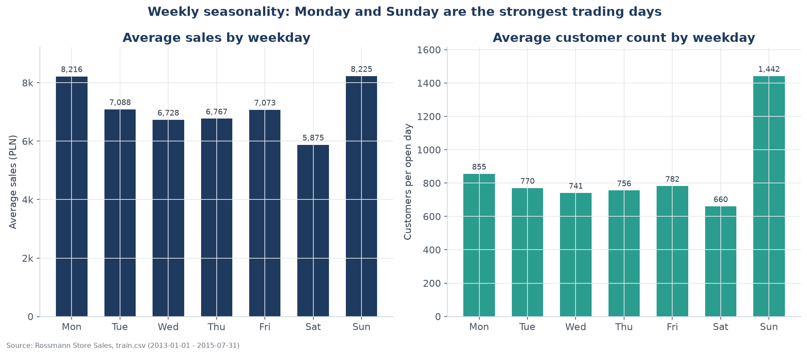
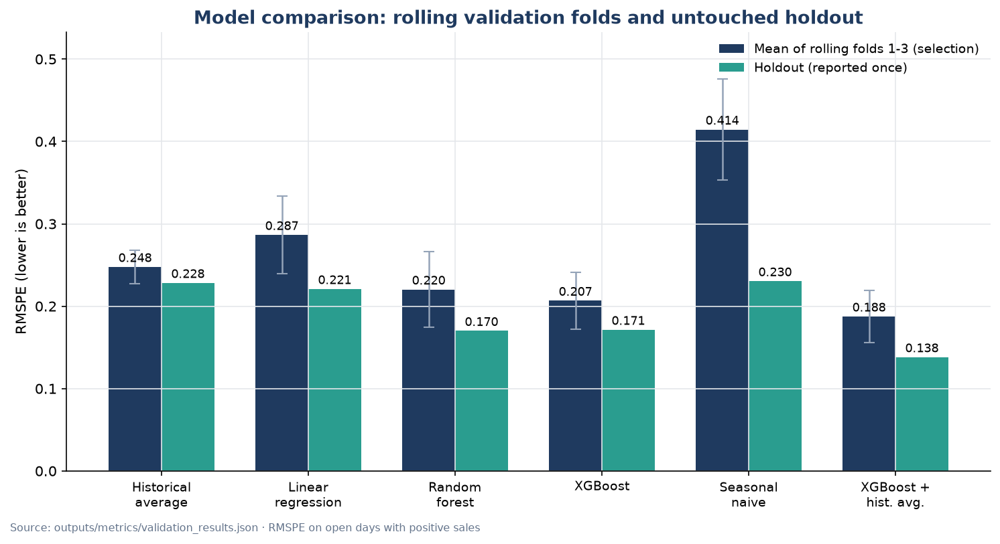
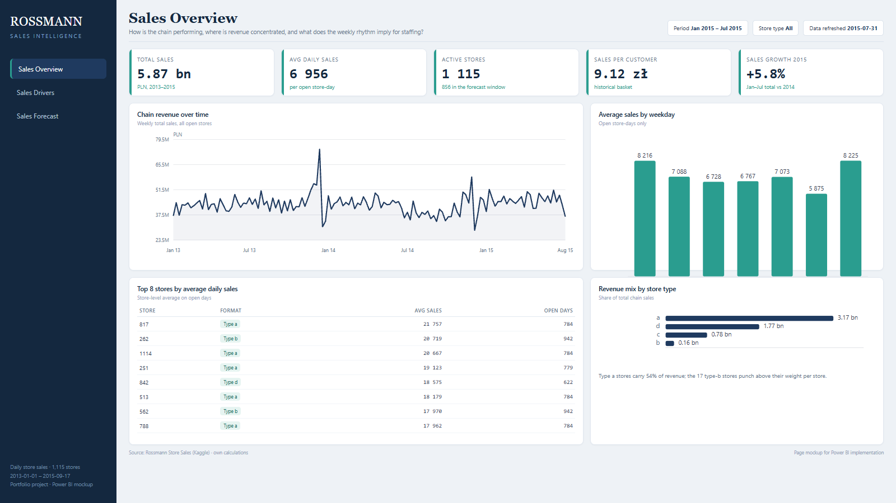
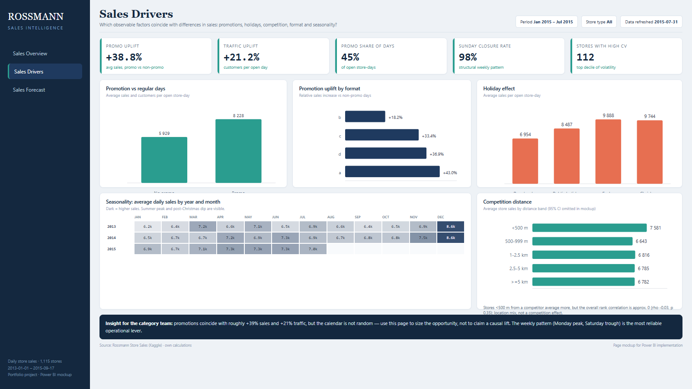
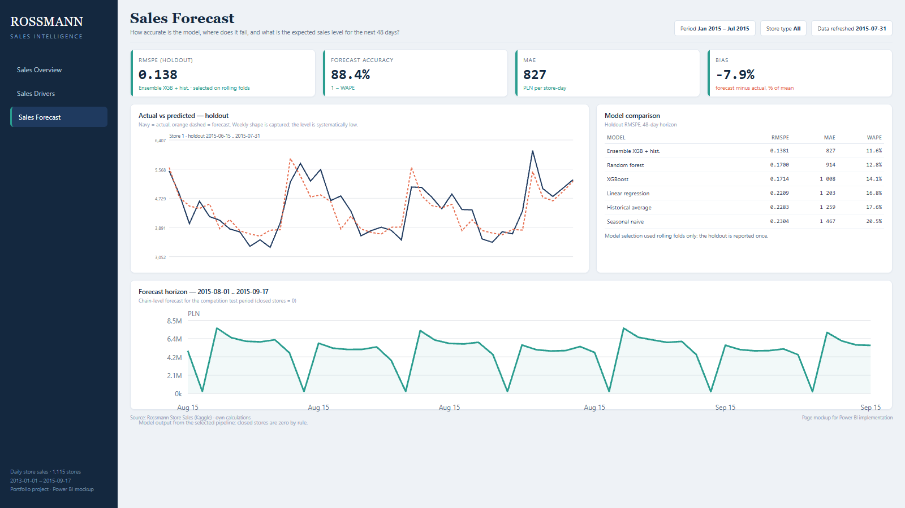

# Rossmann Store Sales Forecasting

[](https://github.com/kicporr/Rossmann-Sales-Forecasting/actions/workflows/ci.yml)
[](https://github.com/kicporr/Rossmann-Sales-Forecasting/blob/main/requirements.txt)
[](reports/model_comparison.md)
[](LICENSE)

**An end-to-end analytics and forecasting project on 1.0 million store-days of German drugstore sales.**

The project predicts daily turnover for 856 stores over a 48-day horizon, compares econometric and machine-learning approaches, and packages the result as a reproducible pipeline, a SQL layer, a Power BI specification and a portfolio-ready report.

> **Scope:** portfolio project for a Junior Data Analyst / Junior Data Scientist role. It is deliberately honest about what the data can and cannot support: no causal claims, no fabricated metrics, and a documented level bias in the holdout.

**Portfolio case study:** [kacper-teichert.pages.dev/projekty/rossmann](https://kacper-teichert.pages.dev/projekty/rossmann/) — a visual walkthrough of the data, model and errors (also in [English](https://kacper-teichert.pages.dev/en/projects/rossmann/)).

---

## Project Overview

| | |
|---|---|
| **Business problem** | Forecast daily sales per store for inventory, staffing and promotion planning |
| **Data** | Kaggle *Rossmann Store Sales*: 1,017,209 training store-days, 1,115 stores, 2013-01-01 – 2015-07-31 |
| **Forecast horizon** | 48 days (2015-08-01 – 2015-09-17), 856 stores, 41,088 store-days |
| **Primary metric** | RMSPE (official competition metric), on open days with positive sales |
| **Selected model** | 65% XGBoost + 35% store-weekday historical average (direct multi-horizon features) |
| **Holdout RMSPE** | **0.1381** (ensemble), vs **0.2283** for the historical-average baseline |
| **Main limitation** | The ensemble still under-forecasts the 2015 summer level by ~8%; this is reported, not hidden |

---

## Business Problem

Rossmann operates a network of drugstores with very different sizes, formats, competition environments and local demand patterns. Daily sales are driven by:

* a strong weekly cycle (Monday peak, Saturday trough, most stores closed on Sunday),
* annual seasonality (summer peak, post-Christmas trough),
* promotions and the Promo2 loyalty programme,
* store format and assortment,
* local competition.

The forecasting task is to produce a store-day sales forecast for a 48-day horizon, using only information available at the forecast origin. The output supports:

* **inventory planning** - how much stock to send to each store,
* **workforce planning** - staffing by weekday and store,
* **promotion planning** - expected lift and post-promotion dip,
* **store monitoring** - which stores are volatile or underperforming.

---

## Dataset Description

| File | Rows | Description |
|---|---:|---|
| `train.csv` | 1,017,209 | store, date, sales, customers, open, promo, state/school holiday |
| `test.csv` | 41,088 | same fields without sales/customers; 48 days × 856 stores |
| `store.csv` | 1,115 | store type, assortment, competition distance/age, Promo2 |
| `sample_submission.csv` | 41,088 | Id, Sales |

Key facts established in `notebooks/01_data_understanding.ipynb`:

* 172,817 closed store-days (17.0%); 97.5% of Sundays are closed.
* 54 open store-days with zero sales (0.005%) - treated as anomalies.
* Only 2.5 years of history: two summer cycles, not enough for a robust annual seasonal estimate.
* 259 stores from training are absent from the test set (renovation/permanent closure).
* 11 missing `Open` values in test are imputed with the store's modal state and flagged.

**Licence:** the raw Kaggle files are not committed to this repository. They are downloaded from the competition page and placed in `data/raw/`. All derived data and code are reproducible from them.

---

## Tools & Technologies

| Layer | Tools |
|---|---|
| Data processing | Python 3.12, pandas, NumPy, PyArrow |
| Modelling | scikit-learn, XGBoost, statsmodels |
| Visualisation | matplotlib, seaborn |
| Database | SQLite (window functions, CTEs, JOINs) |
| Dashboard | Power BI specification, DAX measures, HTML mockups |
| Quality | pytest (17 tests), automated leakage and data-quality checks |
| Reproducibility | YAML configuration, fixed random seeds, one-command pipeline |

---

## Data Preparation

The pipeline (`src/data_preparation.py`):

1. Loads raw files without modification.
2. Cleans store attributes and documents every imputation.
3. Normalises holidays to `0/a/b/c` plus binary flags.
4. Joins store attributes with a validated `many-to-one` LEFT JOIN.
5. Runs 8 automated quality checks and writes `outputs/metrics/data_quality.json`.
6. Writes processed parquet files used by every downstream step.

**Imputation decisions**

| Variable | Missing | Decision |
|---|---:|---|
| `CompetitionDistance` | 3 | median + missing flag |
| Competition start date | 354 | kept unknown (`-1`), no invented date |
| Promo2 dates | 544 | structural (`Promo2 = 0`), not imputed |
| `Open` in test | 11 | store modal state + flag |

A relational copy is built with `python sql/build_database.py`; 13 analytical queries demonstrate JOIN, GROUP BY, CTE and window functions. See `docs/sql_documentation.md`.

---

## Exploratory Data Analysis

**Key findings**

* Average daily sales on open days: **6,955.51 PLN**; median 6,369 PLN; total turnover **5.87 bn PLN**.
* Monday average **8,216 PLN**, Saturday **5,875 PLN** - a ~30% weekly swing.
* Promotions coincide with **+38.8% sales** and **+21.2% customers**; the paired store-level test is positive in 99.9% of stores.
* The top 10% of stores generate **17.8%** of revenue; average sales range from 2,704 to 21,757 PLN.
* Competition distance is essentially uncorrelated with sales (**Spearman rho = -0.028, p = 0.35**).
* 112 stores are in the top decile of volatility (CV > 0.35).



The full analysis, with 14 annotated figures and business interpretation, is in `reports/eda_report.md` and `notebooks/03_exploratory_analysis.ipynb`.

---

## Feature Engineering

46 features in six groups:

| Group | Examples |
|---|---|
| Calendar | weekday, month, week of year, sin/cos, month start/end |
| Store | type, assortment, log competition distance, competition age, Promo2 |
| Promotion | promo flag, yesterday/tomorrow promo, promo share of last 28 days |
| Holiday | school holiday, state holiday a/b/c |
| Sales history | lags 1/7/14/28/365, rolling means 7/28/90/365, rolling std 28, momentum |
| Customer history | 28-day average customers, sales per customer at the origin |

**Leakage prevention**

* All historical features are computed from information strictly before the forecast origin.
* Direct multi-horizon mode uses a **48-day information lag**: a training row for day `t` sees the world as of `t-48`.
* `tests/test_features.py` perturbs all sales after a cutoff, rebuilds the matrix, and asserts that no feature before the cutoff changes.
* `Customers` is never used contemporaneously; only an origin-frozen 28-day average enters the model.

**Why not recursive?** A controlled pilot showed the linear model's holdout RMSPE rising from 0.195 (one-step) to 0.381 (48-day recursive) as errors compounded. The direct approach avoids that failure mode; the trade-off is no reaction to shocks inside the horizon.

---

## Forecasting Methodology

**Validation protocol** (`config/config.yaml`, `src/train.py`):

```
fold_1: train <= 2014-12-31   validate 2015-01-01 .. 2015-02-17
fold_2: train <= 2015-02-17   validate 2015-02-18 .. 2015-04-06
fold_3: train <= 2015-04-06   validate 2015-04-07 .. 2015-05-24
holdout: train <= 2015-06-14  validate 2015-06-15 .. 2015-07-31
```

* Expanding window, fixed 48-day horizon, identical dates for every model.
* Model selection uses the mean RMSPE of folds 1-3 only.
* The holdout is evaluated once, after selection, and never used for tuning.
* The XGBoost component is refitted on all data through 2015-07-31; the historical average is recomputed and the 65/35 blend is applied at prediction time.

**Models**

| Model | Role |
|---|---|
| Historical average (store × weekday) | baseline |
| Seasonal naive (last observed week) | baseline |
| Linear regression (median imputation, standardisation) | interpretable benchmark |
| Random forest (60 trees, depth 18) | non-linear benchmark |
| XGBoost (600 trees, depth 8, lr 0.05) | production candidate |
| 65% XGBoost + 35% historical average | selected ensemble, applied after both components |
| SARIMAX(1,0,1)(1,1,1,7) | single-store econometric benchmark |

---

## Model Comparison

### Rolling validation folds (mean RMSPE, folds 1-3 - used for selection)

| Model | Mean RMSPE | Std | Interpretation |
|---|---:|---:|---|
| **Ensemble (65% XGB + 35% hist.)** | **0.1876** | 0.032 | best average across folds; best bias/accuracy trade-off |
| XGBoost | 0.2067 | 0.039 | best single model |
| Random forest | 0.2203 | 0.052 | close second, slower to train |
| Historical average | 0.2477 | 0.023 | strong, stable baseline |
| Linear regression | 0.2866 | 0.057 | hurt by non-linearity and imputation |
| Seasonal naive | 0.4145 | 0.110 | unstable, worst overall |

### Holdout (2015-06-15 – 2015-07-31, 45,852 scored store-days)

| Model | RMSPE | MAE (PLN) | WAPE | Bias |
|---|---:|---:|---:|---:|
| Ensemble (selected) | **0.1381** | **826.7** | **11.6%** | **-7.9%** |
| Random forest | 0.1700 | 913.5 | 12.8% | -6.8% |
| XGBoost | 0.1714 | 1,008.2 | 14.1% | -10.8% |
| Linear regression | 0.2209 | 1,202.8 | 16.8% | -9.6% |
| Historical average | 0.2283 | 1,259.4 | 17.6% | -2.6% |
| Seasonal naive | 0.2304 | 1,466.7 | 20.5% | -15.2% |

**How to read this table**

* The ensemble is selected on the rolling folds and delivers **0.1381 on the holdout**, a clear improvement over every single model. The XGBoost-only model (0.1714) is 0.0014 behind the random forest (0.1700) on the holdout - inside seasonal noise - which is why the ensemble, not a post-hoc model switch, is the right answer.
* The ensemble improves RMSPE by **~24% vs the historical average** on the selection folds, and by **~40% on the holdout**.
* **Bias is the remaining weakness.** The ensemble under-forecasts the 2015 summer level by 7.9% (XGBoost alone: 10.8%; random forest: 6.8%). The likely cause is a level shift relative to the 2014 summer used in training. A production system would calibrate on the most recent observed window; the submission is deliberately left uncalibrated and the bias is disclosed.



*Rolling-fold bars show mean ± standard deviation across folds 1-3; the holdout is a single 47-day window. The full table, including MAE, WAPE and bias, is in `reports/model_comparison.md`.*

---

## Results

**Holdout (48 days, 856 stores):**

* RMSPE **0.1381**, MAE **827 PLN**, WAPE **11.6%** for the selected 65/35 ensemble.
* Best single model on the holdout: random forest, RMSPE **0.1700**, MAE **914 PLN**, WAPE **12.8%**.
* Baseline historical average: RMSPE **0.2283**, MAE **1,259 PLN**. The ensemble reduces RMSPE by **39.5%** relative to this baseline.

**Submission:**

* `outputs/predictions/submission.csv`, 41,088 rows, Id order matches `sample_submission.csv`.
* Mean predicted sales **5,642 PLN** per store-day, median **5,760 PLN**, 14.6% zeros (closed days).
* No negative values; all closed stores predicted as zero.
* The file has **not** been uploaded to Kaggle; the project does not submit on the user's behalf.

**Submitting to Kaggle (optional, requires your credentials)**

```bash
# one-time: put your API token in ~/.kaggle/kaggle.json
kaggle competitions submit -c rossmann-store-sales -f submission.csv -m "XGBoost, direct 48-day features"
```

Do not run this without explicit approval: it publishes the score under your account.

**Econometric benchmark (Store 1, 41 scored days):** SARIMAX RMSPE **0.1234**, global linear regression **0.1032**, global XGBoost **0.1264**. A single-store model can beat a global model on its own series; the global model wins on scalability and cross-store learning.

---

## Business Insights

1. **Plan staffing around Monday, not the weekly average.** Monday sales are ~40% above Saturday; a flat staffing model is wrong every week.
2. **Promotions are a traffic lever.** +38.8% sales and +21.2% customers on promo days. Treat this as a sizing input, not a causal ROI - promotion timing is endogenous.
3. **Segment by store format.** Type b stores have high sales but the lowest basket (5.06 PLN); type d has the highest basket (11.25 PLN). A single promotion or assortment playbook leaves money on the table.
4. **Watch the volatile tail.** 112 stores have CV above 0.35; they need wider safety stock and more frequent re-forecasting.
5. **Competition distance is a control, not a lever.** The near-zero correlation means opening closer to a competitor is not supported by this data.
6. **Apply a bias buffer.** The ensemble under-forecasts the summer level by ~8%; inventory plans should carry a safety margin until calibration is implemented.

Full recommendations, with observation → conclusion → business meaning → limitations, are in `reports/business_recommendations.md`.

---

## Dashboard

The ready-to-open report is **`dashboard/Rossmann-Sales-Dashboard.pbix`**. It has three pages (overview, drivers, forecast/error), an import data model and the aggregated data cached inside the file; open it without any external CSV. Refreshing the model requires the flat files in `dashboard/data/`.

* `dashboard/Rossmann-Sales-Dashboard.pbix` - working Power BI report with the Rossmann model and measures.
* `dashboard/dashboard_specification.md` - data model, relationships, page layouts and interactions.
* `dashboard/dax_measures.md` - 30+ production-ready DAX measures, including RMSPE and WAPE.
* `dashboard/data/` - flat-file exports used by the model queries.
* `dashboard/mockups/` - high-fidelity page mockups (HTML + PNG) kept as design references.







---

## Repository Structure

```
rossmann-sales-forecasting/
├── config/config.yaml           # paths, splits, model hyperparameters
├── data/
│   ├── raw/                     # Kaggle files (gitignored)
│   └── processed/               # parquet + SQLite (gitignored, regenerable)
├── notebooks/                   # 8 executed notebooks, 01 → 08
├── src/
│   ├── config.py
│   ├── data_preparation.py
│   ├── features.py              # leakage-safe features + direct forecaster
│   ├── train.py                 # rolling-origin validation, model selection
│   ├── predict.py               # submission generation
│   ├── evaluation.py            # RMSPE, MAE, RMSE, WAPE, error breakdown
│   ├── eda.py                   # 14 figures + EDA summary
│   ├── econometrics.py          # ADF, ACF/PACF, OLS, SARIMAX
│   └── dashboard_export.py      # Power BI flat files
├── sql/
│   ├── create_tables.sql
│   ├── analytical_queries.sql   # 13 queries with CTE / window functions
│   └── build_database.py
├── dashboard/                   # working .pbix, spec, DAX, mockups, data export
├── reports/                     # EDA, model comparison, business recommendations
├── docs/                        # methodology, learning guide, CV, interview Q&A
├── portfolio/                   # PL/EN case study + home-page integration snippets
├── scripts/                     # repository hygiene checks
├── tests/                       # 17 pytest tests, including anti-leakage
└── outputs/                     # figures, metrics, predictions, model artefacts
```

---

## How to Reproduce

**Requirements:** Python 3.12 (tested with 3.12.7), ~16 GB RAM, 6 CPU cores.

```bash
# 0. Clone the repository
git clone https://github.com/kicporr/Rossmann-Sales-Forecasting.git
cd rossmann-sales-forecasting

# 1. Install dependencies
python -m venv .venv
.venv\Scripts\activate          # Windows
pip install -r requirements.txt

# 2. Place the four Kaggle files in data/raw/
#    train.csv, test.csv, store.csv, sample_submission.csv

# 3. Run the pipeline
python -m src.data_preparation
python -m src.train             # rolling validation, ~15-20 min on 6 cores
python -m src.predict           # final model + submission.csv
python -m src.dashboard_export
python sql/build_database.py
python -m src.eda
python -m src.econometrics

# 4. Quality gates
pytest -q                       # 17 tests; 6 feature tests skip if data/processed is absent
python scripts/check_repo_hygiene.py
```

The notebooks are already executed and can be run top-to-bottom; 01-04 do not depend on model training, 05-08 require the pipeline outputs.

**Expected runtime:** validation ~16 min (mostly random forest), final model ~1 min, EDA ~20 s, econometrics ~20 s, SQL build ~100 s.

---

## Project Limitations

1. **Summer level shift.** The 2015 holdout is stronger than 2014; the ensemble under-forecasts by 7.9%. The submission is uncalibrated and the bias is disclosed.
2. **No causal inference.** Promotions are not randomly assigned; all promotion statements are associations.
3. **Annual seasonality from two cycles.** The summer level estimate is fragile.
4. **No weather, local events, competitor openings or assortment changes.**
5. **Static competition distance** - one snapshot, no time series.
6. **Closed-day rule** - an unexpected opening is forecast as zero.
7. **Single holdout.** Rolling folds mitigate, but do not eliminate, seasonal luck.
8. **SARIMAX is single-store** and not a scalable chain-wide solution.

---

## Future Improvements

* **Bias calibration** on the most recent 48-day window (better inventory behaviour; the remaining bias is ~8%).
* **Weekly re-forecasting** with a shorter horizon to react to demand shocks.
* **Extend the ensemble** with the random forest and a segment-specific linear model; the current 65/35 blend is deliberately simple and explainable.
* **Hierarchical reconciliation** (store → region → chain) so that store forecasts sum to a coherent chain plan.
* **External data**: weather, local events, competitor openings, school calendars.
* **MLflow / DVC** for experiment tracking and data versioning.
* **Power BI service deployment** (the `.pbix` is local-only; publishing needs a workspace account).

---

## Project Documents

| Document | Content |
|---|---|
| `reports/eda_report.md` | 14 figures, statistical tests, business interpretation |
| `reports/model_comparison.md` | full fold-by-fold comparison, error analysis |
| `reports/business_recommendations.md` | observation → conclusion → action → limitation |
| `reports/data_quality_report.md` | schema, missingness, checks, accepted risks |
| `reports/econometric_analysis.md` | ADF, decomposition, OLS, SARIMAX diagnostics |
| `docs/methodology.md` | end-to-end methodological rationale |
| `docs/data_dictionary.md` | every processed column |
| `docs/sql_documentation.md` | schema, 13 queries, example results |
| `docs/learning_guide.md` | 20 concepts explained for interviews (PL) |
| `docs/interview_questions.md` | 10 interview questions with answers (PL) |
| `docs/cv_description.md` | CV / LinkedIn descriptions (PL + EN) |
| `docs/github-metadata.md` | repository description, topics, release checklist |
| `PUBLISHING.md` | GitHub push and portfolio deployment checklist (PL) |

---

## Licence and Data Use

The code in this repository is released under the [MIT licence](LICENSE). The Rossmann dataset is subject to the Kaggle competition terms and is **not** redistributed here. The repository contains only code, derived aggregates and figures.

---

## Contact

This is a portfolio project. If you want to discuss the methodology, the model comparison or the dashboard, open an issue or reach out via the contact details on the profile.
