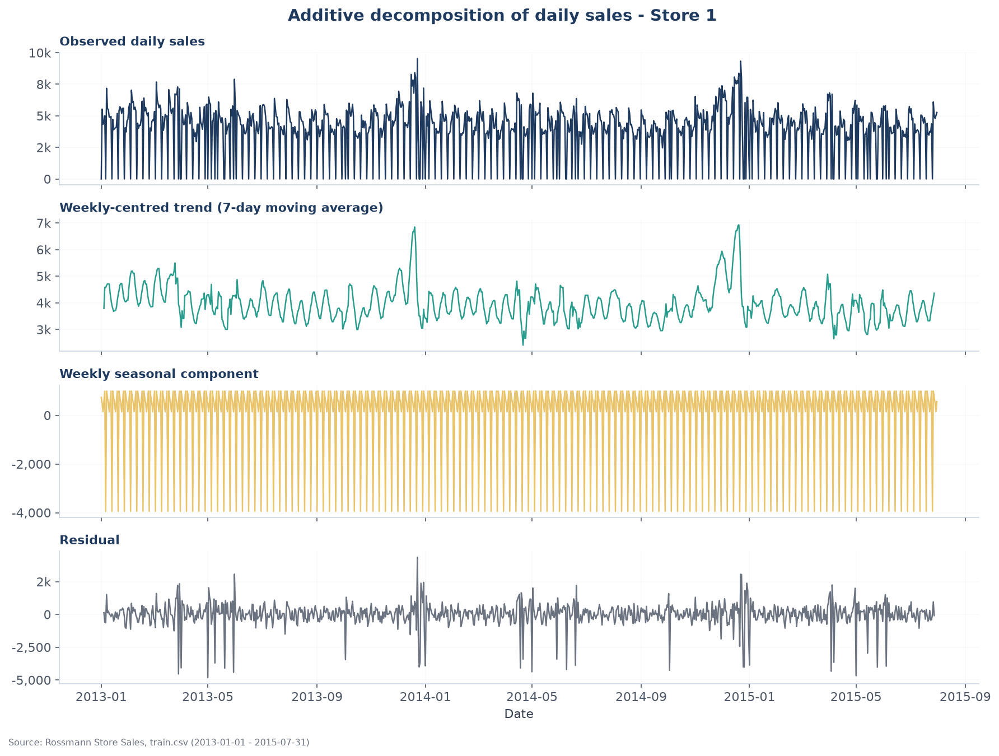
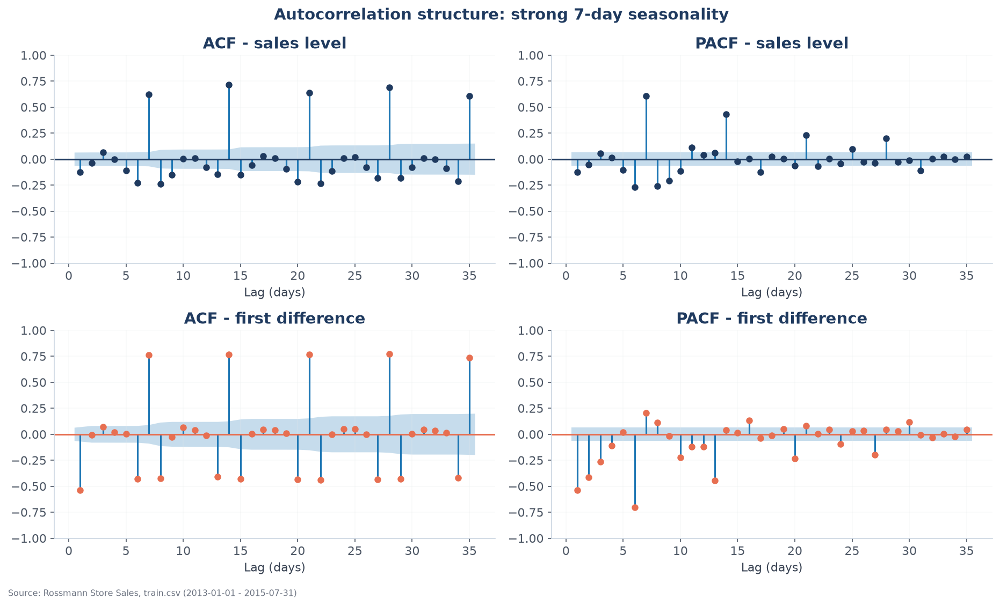
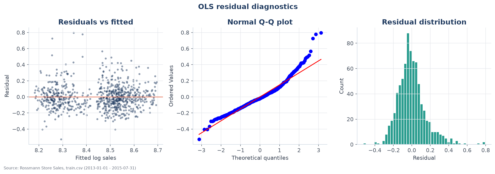
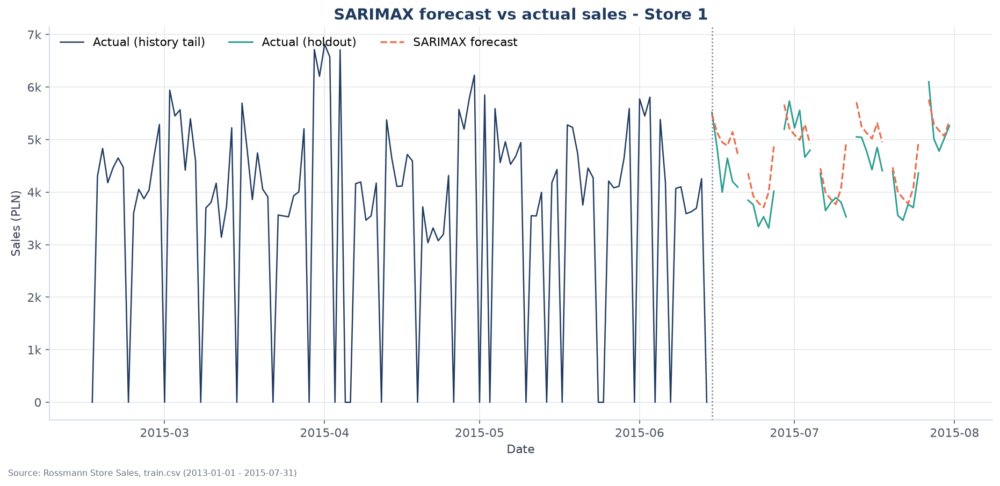
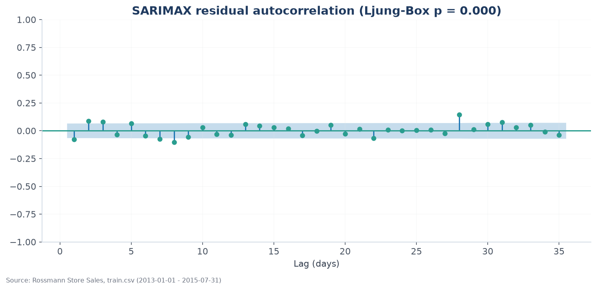

# Econometric Analysis Report

**Script:** `python -m src.econometrics`  
**Machine-readable results:** `outputs/metrics/econometrics_summary.json`, `outputs/metrics/ols_coefficients.csv`  
**Store analysed:** Store 1, daily series 2013-01-01 – 2015-07-31 (942 days, closed days explicitly zero)

---

## 1. Stationarity (ADF tests)

| Series | n | ADF statistic | p-value | Verdict at 5% |
|---|---:|---:|---:|---|
| Chain daily sales | 942 | -4.762 | 6.4e-05 | stationary |
| Chain daily sales, first difference | 941 | -14.009 | 3.8e-26 | stationary |
| Chain weekly sales | 135 | -4.858 | 4.2e-05 | stationary |
| Chain weekly sales, first difference | 134 | -8.570 | 8.3e-14 | stationary |
| Store 1 daily sales | 942 | -4.368 | 3.4e-04 | stationary |
| Store 1 daily sales, first difference | 941 | -11.494 | 4.7e-21 | stationary |

**Reading.** The test rejects the unit root in every specification, including the levels. That is plausible given 20+ augmentation lags and strong weekly mean reversion, but it should not be over-read: ADF has low power against near-unit-root alternatives and is sensitive to deterministic seasonality and structural breaks. The practical conclusion is that first differences are *more* clearly stationary, and that a seasonal component is essential.

**For an interview:** "ADF rejected non-stationarity for all series, so I did not force differencing in every model. I still used a seasonal difference in SARIMAX because the ACF shows a persistent lag-7 spike, which is a seasonal pattern, not a unit root."

---

## 2. Decomposition and autocorrelation

**Specification:** additive decomposition, period = 7 days, Store 1.

**Seasonal strength:** 0.761, computed as `1 - Var(residual) / Var(seasonal + residual)`. About three quarters of the variation around the trend is weekly seasonality.

**Interpretation.** The trend component is a 7-day centred moving average; it absorbs the weekly cycle and leaves a slow drift. The seasonal component is stable and large. The residual still contains promotion and holiday effects, which is why the regression and SARIMAX include them explicitly.

**Interpretation.** The level ACF decays slowly and has a clear spike at lag 7. The PACF cuts off after a few lags. After first differencing, the lag-7 spike remains, which motivates a seasonal difference of order 7.

**Caveat.** Closed Sundays create zeros every week. That is a deterministic operational pattern, not demand; it inflates autocorrelation at multiples of 7. The model must know the weekday, not "learn" Sunday from the series alone.

---

## 3. OLS regression with HC3 standard errors

**Specification:** `log(Sales) ~ Promo + C(DayOfWeek) + SchoolHoliday + trend_days` on 781 open days of Store 1. Store 1 never opens on Sunday and has no state-holiday variation, so those terms are automatically excluded (otherwise the design would be rank-deficient).

| Term | Coefficient | Approx. effect | p-value |
|---|---:|---:|---:|
| Intercept | +8.419 | baseline level | ≈ 0 |
| Tuesday | -0.0897 | -8.6% vs Monday | ≈ 0 |
| Wednesday | -0.1136 | -10.7% | ≈ 0 |
| Thursday | -0.1393 | -13.0% | ≈ 0 |
| Friday | -0.0700 | -6.8% | 6e-04 |
| Saturday | +0.1215 | +12.9% | ≈ 0 |
| Promo | +0.2754 | +31.7% | ≈ 0 |
| SchoolHoliday | +0.0014 | +0.1% | 0.935 (not significant) |
| trend_days | -0.0001 | -0.01% per day | ≈ 0 |

**Diagnostics**

| Metric | Value | Reading |
|---|---:|---|
| R² | 0.444 | the model explains 44% of log-sales variance |
| Adjusted R² | 0.439 | stable after penalising 9 parameters |
| F statistic | 95.0 | jointly significant |
| Durbin-Watson | 0.864 | strong positive autocorrelation (2 = none) |
| Jarque-Bera p | 1.0e-85 | residuals not normal |
| Breusch-Pagan p | 1.1e-04 | heteroskedasticity |
| Residual std | 0.153 | ~15% typical unexplained variation |

**Interpretation.** Promotions are associated with a +31.7% sales level at this store, after controlling for weekday, school holidays and trend. Saturday is the strongest trading weekday; Thursday the weakest. School holidays are not significant for this store.

**Why the diagnostics matter.** HC3 fixes standard errors for heteroskedasticity but not for autocorrelation. With DW = 0.86, the OLS standard errors are too optimistic. The coefficient signs and magnitudes are informative; the p-values should be treated as indicative. This is exactly why the project also fits a model with an explicit time-series error structure.

**Interpretation.** Residuals show fat tails and a few large misses around promotions and holidays. The Q-Q plot deviates at both ends. A linear model in logs cannot capture interactions such as "promotions work differently in large stores".

---

## 4. SARIMAX on Store 1

**Specification:** SARIMAX(1,0,1)(1,1,1,7), exogenous: `Promo`, `SchoolHoliday`, state-holiday flags and weekday dummies. Trained up to 2015-06-14, evaluated on 2015-06-15 – 2015-07-31 (the same holdout as the ML models).

**Fit**

| Metric | Value |
|---|---:|
| AIC | 13,806.7 |
| BIC | 13,883.2 |
| Converged | yes |
| Residual std | 684.6 PLN |
| Ljung-Box lag 7 p | 9.4e-05 |
| Ljung-Box lag 14 p | 6.0e-06 |
| Jarque-Bera p | < 1e-300 |

**Holdout accuracy**

| Metric | Value |
|---|---:|
| RMSPE | 0.1234 |
| MAE | 404.1 PLN |
| RMSE | 498.3 PLN |
| WAPE | 9.1% |
| Bias | +319.8 PLN (+7.2% of mean) |

**Interpretation.** SARIMAX captures the weekly shape and the promotion effect, and achieves RMSPE 0.123 on this store - better than the global XGBoost model's holdout result on the same store (see `outputs/metrics/store1_model_comparison.csv`). That is not a contradiction: a model fitted directly to one stable series can beat a global model that must trade off 1,115 stores. The global model wins on scalability, cold-start behaviour and cross-store learning; SARIMAX wins on interpretability and, sometimes, on a single well-behaved series.

**Residual problems.** Ljung-Box rejects white noise at lags 7 and 14: the model has not absorbed all weekly autocorrelation, and the residuals are non-normal. The forecast bias (+7.2%) means the model over-predicts this particular holdout, while the global ML model under-predicts it. Neither is calibrated.

---

## 5. Single-store comparison

The table is generated only when the validation predictions exist (after `python -m src.train` and a rerun of this module):

`outputs/metrics/store1_model_comparison.csv`

| Model | RMSPE | MAE (PLN) | n scored |
|---|---:|---:|---:|
| Linear regression (global) | 0.1032 | 367.0 | 41 |
| Random forest (global) | 0.1115 | 400.0 | 41 |
| SARIMAX (Store 1 only) | 0.1234 | 404.1 | 41 |
| XGBoost (global) | 0.1264 | 433.7 | 41 |
| Seasonal naive | 0.1782 | 713.4 | 41 |
| Historical average | 0.2017 | 669.7 | 41 |

**How to read it.** The comparison is on the same store and the same 47 holdout days, but the global models were trained on all stores, not on Store 1 alone. On this particular store the global linear regression is the best model (0.103), followed by the random forest and SARIMAX; XGBoost, the chain-wide winner, is only fourth. This is not a contradiction: with 41 scored days, store-level differences are noisy, and a model that wins on average across 856 stores need not win on every individual series. The comparison answers "which model would I deploy for this store", not "which algorithm is universally better".

**Implication for the portfolio narrative.** Report the global ranking from the rolling folds, and use this table to show that model selection is objective-specific: a single-store econometric model can beat a global ML model on its own series, but it does not scale to 1,115 stores and cannot borrow strength from similar locations.

---

## 6. What the econometric analysis adds

1. **Interpretable effects.** Promotion +31.7%, Saturday +12.9%, Thursday -13.0% for Store 1, with a clear baseline.
2. **Explicit seasonality.** Decomposition and ACF show that the weekly cycle is structural, not noise.
3. **Diagnostics that ML hides.** Autocorrelated, heteroskedastic, non-normal residuals are visible and documented.
4. **A genuine benchmark.** SARIMAX is competitive on a single stable series; it is not a scalable chain-wide solution.

## 7. Limitations

* One store only; results do not generalise to all 1,115 stores.
* The series includes deterministic Sunday zeros, which distort ACF and SARIMA estimates.
* Annual seasonality cannot be estimated from 2.5 years.
* No weather, local events or competitor openings.
* The model is not calibrated; the +7.2% holdout bias is reported, not corrected.
