# Exploratory Data Analysis Report

**Dataset:** Rossmann Store Sales (Kaggle)  
**Period:** 2013-01-01 – 2015-07-31 (train), 2015-08-01 – 2015-09-17 (test horizon)  
**Scope:** 1,017,209 store-day rows, 1,115 stores, 5.87 bn PLN of turnover

All figures are generated by `src/eda.py`; all numbers in this report are read from `outputs/metrics/eda_summary.json`.

---

## Executive summary

1. **The business is large but highly concentrated.** The top 10% of stores generate 17.8% of revenue, and average daily sales range from 2,704 PLN (store 307) to 21,757 PLN (store 817).
2. **Weekly seasonality is the strongest predictable pattern.** Monday averages 8,216 PLN per open store-day; Saturday only 5,875 PLN. Sundays are mostly closed (97.5%), which creates the saw-tooth in the daily chain series.
3. **Promotions coincide with materially higher sales and traffic.** Average sales are +38.8% and customers +21.2% on promo days. The store-level paired test confirms the association in 99.9% of stores, but promotions are not randomly assigned, so this is not a causal estimate.
4. **Annual seasonality exists but is estimated from only two summer cycles.** 2015 is consistently above 2013-2014, a level shift that matters for forecasting.
5. **Competition distance is almost uncorrelated with store sales** (Spearman rho = -0.03, p = 0.35). The apparent advantage of stores with a competitor within 500 m is a location-mix effect, not evidence that competition raises sales.
6. **Customers are almost collinear with sales** (Spearman rho > 0.9), but they are unknown at forecast time and can only enter the model as lagged, origin-frozen features.

---

## 1. Data overview

| Metric | Value |
|---|---:|
| Rows (store-days) | 1,017,209 |
| Stores | 1,115 |
| Date range | 2013-01-01 – 2015-07-31 |
| Total sales | 5,873,180,623 PLN |
| Total customers | 644,041,755 |
| Average sales, open days | 6,955.51 PLN |
| Median sales, open days | 6,369 PLN |
| Average customers, open days | 762.7 |
| Sales per customer | 9.12 PLN |
| Open rate | 83.0% |
| Closed store-days | 172,817 |
| Open but zero sales | 54 rows (0.005%) |

The 54 open-but-zero rows are treated as anomalies: they are removed from model fitting and from the RMSPE denominator, but kept in the dataset so the decision is auditable.

---

## 2. Time analysis

### 2.1 Daily chain revenue and trend

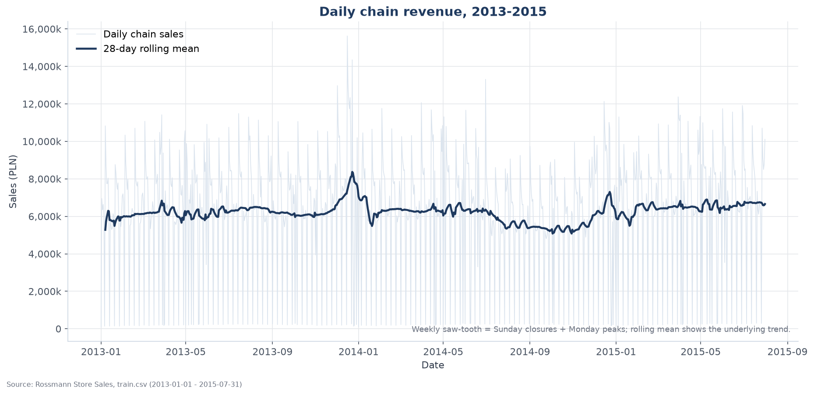

**Variables:** daily sum of sales across all stores; 28-day rolling mean.

**Interpretation.** The daily series has a strong weekly saw-tooth caused by Sunday closures and Monday peaks. The rolling mean shows three regimes: gradual growth through 2013, a decline in late 2014, and a recovery in the first half of 2015. There is no exponential growth; this is a mature store network.

**Business meaning.** Daily noise is mostly calendar-driven; workforce and replenishment planning should use the weekly profile, while annual budgeting should use the rolling trend. A single "average day" is misleading.

### 2.2 Weekly seasonality

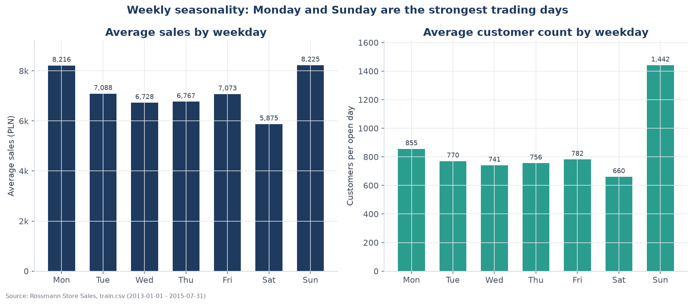

| Weekday | Avg sales (PLN) | Avg customers | Open store-days |
|---|---:|---:|---:|
| Monday | 8,216 | 855 | 137,560 |
| Tuesday | 7,088 | 770 | 143,961 |
| Wednesday | 6,728 | 741 | 141,936 |
| Thursday | 6,767 | 756 | 134,644 |
| Friday | 7,073 | 782 | 138,640 |
| Saturday | 5,875 | 660 | 144,058 |
| Sunday | 8,225 | 1,442 | 3,593 |

**Interpretation.** Monday and Sunday have the highest sales per open store-day, but for opposite reasons: Monday is a full-network peak, while Sunday's figure is based on only 3,593 open store-days (high-traffic locations that choose to open). Saturday is the weakest full-network day.

**Business meaning.** Staffing should peak on Monday. Sunday openings are a strategic decision concentrated in strong locations, not a typical trading day. A model that ignores weekday will be wrong by up to ~40% on individual days.

### 2.3 Annual seasonality

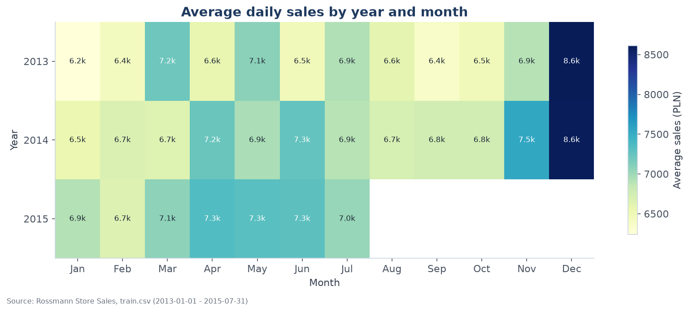

**Interpretation.** Sales peak in late spring and summer (June-August) and fall after Christmas. December is strong but volatile because of holiday shopping and closures. 2015 is generally above the same months in 2013-2014, reflecting network maturity and possibly a stronger consumer environment.

**Caution.** With 30 months of data, the annual pattern is based on two summer seasons. It is a description, not a robust seasonal estimate; the model uses month/day-of-year features but does not extrapolate a long-term seasonal trend.

**Business meaning.** Inventory build-up should start before the summer peak; January planning should assume a post-Christmas trough. Year-over-year comparisons must be seasonally adjusted.

### 2.4 Distribution of daily sales

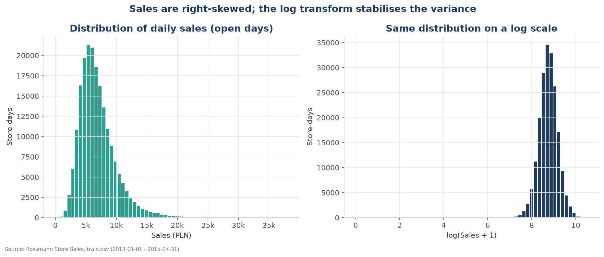

**Interpretation.** Sales are strongly right-skewed: median 6,369 vs mean 6,956, with a long tail above 40,000 PLN. On a log scale the distribution is close to symmetric. This motivates the `log1p` target transform and percentage-error metrics.

**Business meaning.** Averages are pulled up by large stores. Segment reporting (store type, size decile) is more informative than a chain-wide average.

### 2.5 Opening pattern

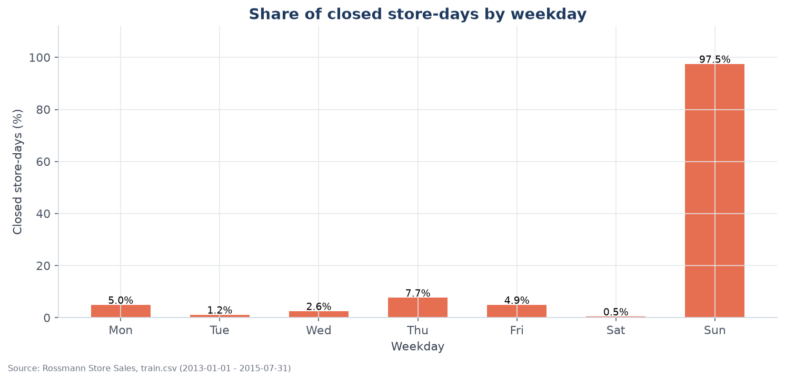

**Interpretation.** 97.5% of Sundays are closed; Sundays account for 82% of all closed store-days. Other weekdays are closed only about 3-4% of the time (renovations, local holidays).

**Business meaning.** Closure is a deterministic calendar rule, not missing demand. Forecasting closed days as zero is correct; including them in an average is not.

---

## 3. Store analysis

### 3.1 Store ranking

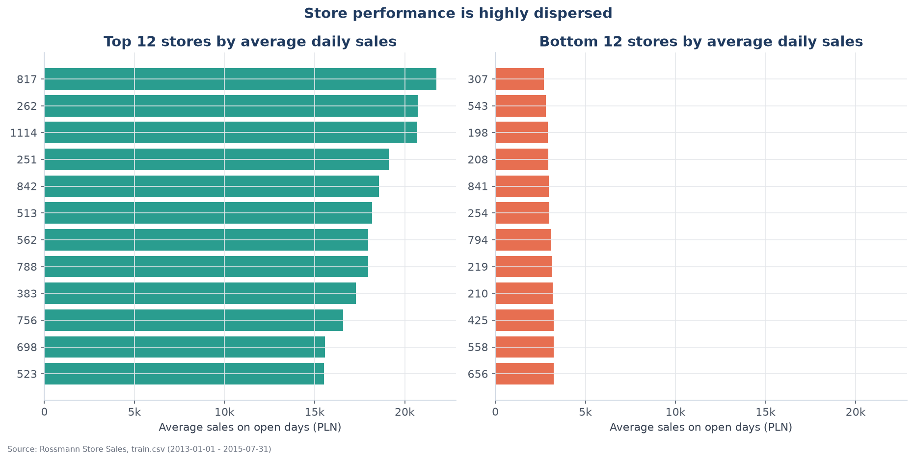

**Interpretation.** Store 817 averages 21,757 PLN per open day; store 307 averages 2,704 PLN. The ten largest stores are 2-3× the chain average. Store type b is over-represented among the top performers.

**Business meaning.** Store-level history is essential. A single global average would over-forecast small stores and under-forecast large ones by an order of magnitude.

### 3.2 Volatility

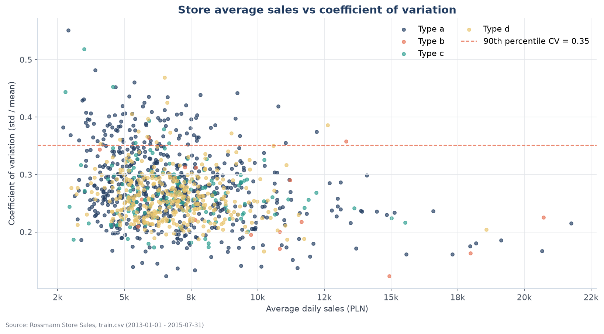

**Variables:** average daily sales (x) and coefficient of variation (y), coloured by store type.

**Interpretation.** Median CV is 0.264; the 90th percentile is 0.352, identifying 112 high-volatility stores. Volatility is not strongly related to store size: some large stores are stable, some small stores are erratic.

**Business meaning.** High-CV stores need wider safety stock and more frequent re-forecasting. They are also where a single RMSPE number hides the most operational risk.

### 3.3 Store formats and assortment

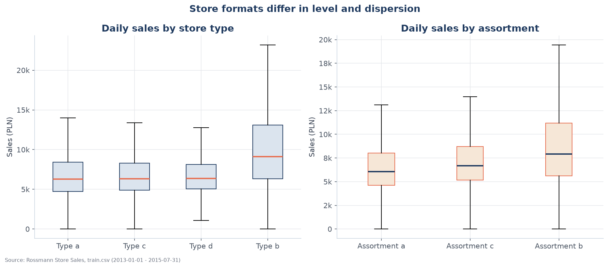

| Store type | Stores | Avg sales | Avg customers | Avg basket |
|---|---:|---:|---:|---:|
| a | 602 | 6,925 | 795 | 8.71 |
| b | 17 | 10,231 | 2,022 | 5.06 |
| c | 148 | 6,933 | 815 | 8.50 |
| d | 348 | 6,822 | 606 | 11.25 |

**Interpretation.** Type b stores are large-footfall, low-basket outlets: high sales, many customers, smallest basket. Type d has the highest basket (11.25 PLN) but fewer customers. Assortment c is the strongest of the three assortment levels (7,301 PLN vs 6,621 for assortment a).

**Business meaning.** Format is not just a label: it changes the traffic/basket mix. Promotion and staffing playbooks should differ by format. Differences are statistically significant (Kruskal-Wallis p < 1e-100), but the practical effect is the segment profile, not the p-value.

---

## 4. Promotion analysis

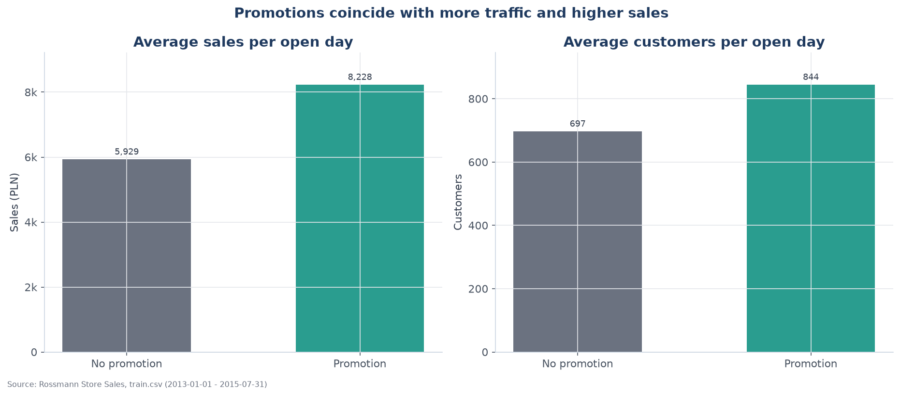

| Segment | Open store-days | Avg sales | Avg customers | Avg basket |
|---|---:|---:|---:|---:|
| No promotion | 467,496 | 5,929 | 697 | 8.51 |
| Promotion | 376,896 | 8,228 | 844 | 9.74 |

**Interpretation.** Promotion days show +38.8% sales and +21.2% customers, and the basket is also higher (9.74 vs 8.51 PLN). The store-level paired test gives a mean uplift of 2,299 PLN per store, positive in 99.9% of the 1,115 stores (Cohen's dz = 2.25). This is a strong, consistent association.

**Causal caution.** Promotions are planned by the retailer, not randomly assigned. They may be scheduled in weeks that were already expected to be strong, and the analysis ignores post-promotion dips and cross-store cannibalisation. The correct claim is "promotion days coincide with higher sales", not "promotions cause +38.8%".

**Business meaning.** Promotions are a powerful lever for traffic and basket, but the ROI calculation requires margin data and a proper control group, neither of which is in this dataset.

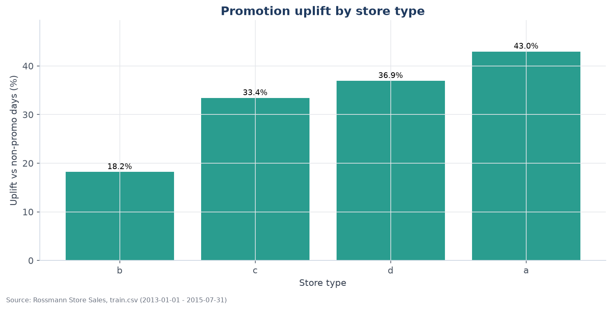

**Interpretation.** Type d stores show the largest relative uplift (+42%), type a the smallest (+5%). Type b has only 17 stores, so its estimate is noisy. The heterogeneity means a single "promo coefficient" would be misleading; the model can learn interactions through store type and history features.

---

## 5. Holidays and competition

### 5.1 State holidays

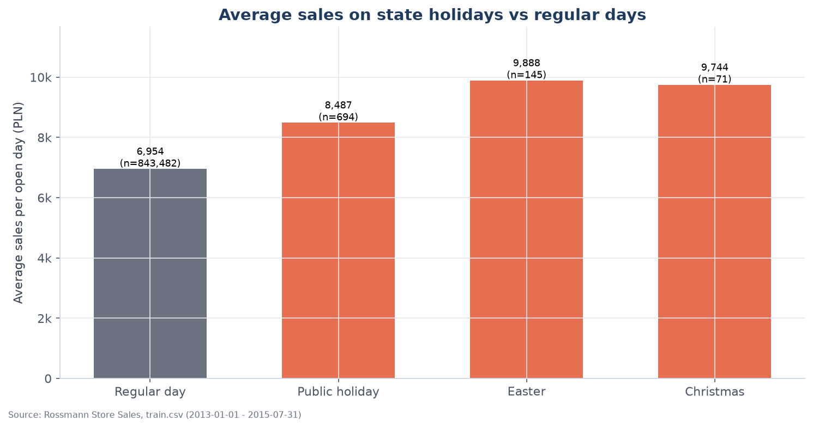

| Holiday type | Open store-days | Avg sales | Avg customers |
|---|---:|---:|---:|
| Regular day | 843,482 | 6,954 | 762 |
| Public holiday (a) | 694 | 8,487 | 1,279 |
| Easter (b) | 145 | 9,888 | 1,687 |
| Christmas (c) | 71 | 9,744 | 1,569 |

**Interpretation.** Open stores on public holidays serve far more customers than on regular days, but only a small subset of stores opens. Christmas has only 71 open store-days, so its average is anecdotal.

**Business meaning.** Holiday opening is a strategic decision; where stores open, they are busy. Forecasts should learn the holiday flag, but should not treat the Christmas average as a stable seasonal effect.

### 5.2 Competition distance

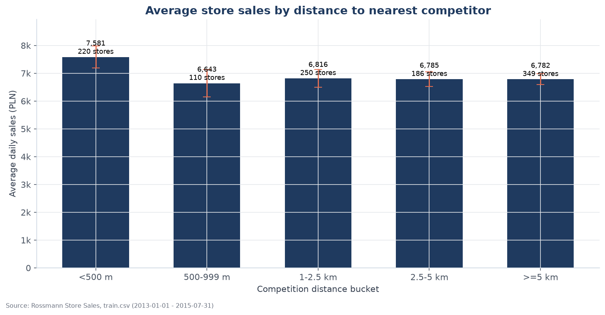

| Distance to competitor | Stores | Avg sales |
|---|---:|---:|
| < 500 m | 220 | 7,581 |
| 500-999 m | 110 | 6,643 |
| 1-2.5 km | 250 | 6,816 |
| 2.5-5 km | 186 | 6,785 |
| >= 5 km | 349 | 6,782 |

**Interpretation.** Stores with a competitor within 500 m average ~12% higher sales, but the overall rank correlation is essentially zero (rho = -0.028, p = 0.35). The bucket difference is driven by location mix: dense city centres contain both competitors and high-footfall stores. The chart is not evidence that proximity to a competitor increases sales.

**Business meaning.** Competition distance is a control variable, not a lever. Store-opening decisions need footfall, rent and catchment data that are not in this dataset.

---

## 6. Customers and correlation structure

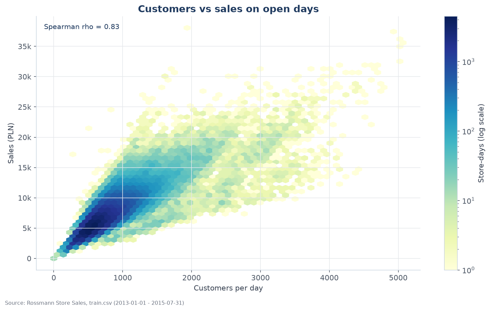

**Interpretation.** Customers and sales are almost perfectly rank-correlated (rho > 0.9). Traffic is the main driver of revenue; basket variation is secondary.

**Leakage implication.** Customers are unknown for future days. Using the contemporaneous customer count would produce an unrealistically accurate forecast and fail in production. The model uses only a 28-day customer average frozen at the forecast origin.

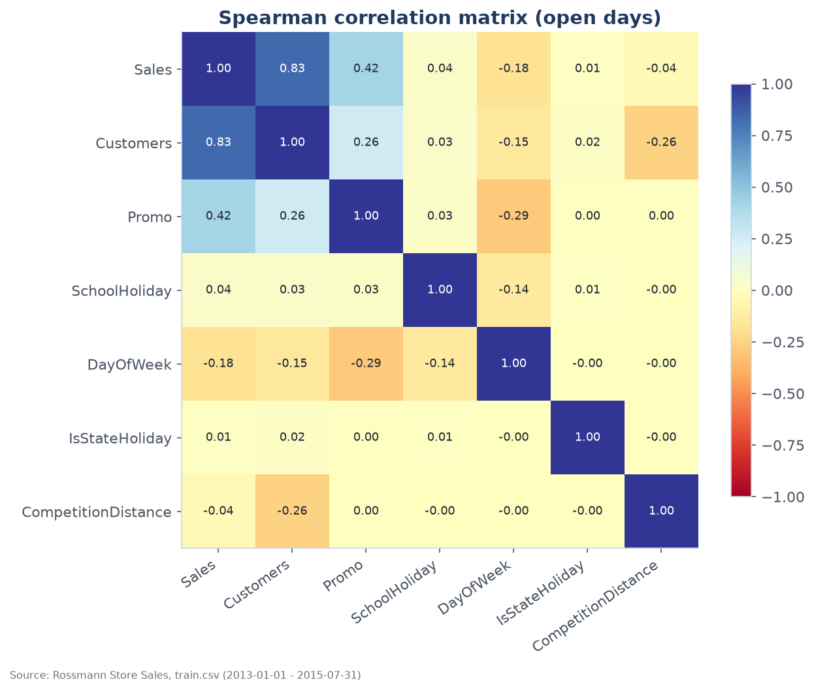

**Caution.** Pooled store-day correlations mix between-store and within-store variation. The negative `Promo`–`DayOfWeek` correlation reflects the promotion calendar, not customer behaviour. The matrix is a screening tool, not a causal model.

---

## 7. Statistical tests

| Test | Statistic | p-value | Reading |
|---|---:|---:|---|
| Promo effect, paired t-test across stores | 74.97 | < 1e-300 | +2,299 PLN mean uplift; 99.9% of stores positive |
| Weekday differences, Kruskal-Wallis | 43,128 | ≈ 0 | Weekly seasonality is real and large |
| Store type differences, Kruskal-Wallis | 8,221 | ≈ 0 | Formats differ in level and dispersion |
| Holiday differences, Kruskal-Wallis | 74.49 | 4.7e-16 | Holiday trading differs, but sample sizes are small |
| Competition distance vs sales, Spearman | rho = -0.028 | 0.353 | No meaningful monotonic relationship |

**How to read p-values here.** With hundreds of thousands of observations, almost any difference becomes statistically significant. The effect size and business relevance matter more. The competition result is the opposite case: a small correlation and a non-significant p-value, so the honest conclusion is "no detectable relationship".

---

## 8. Findings that shaped the model

1. **Store-level history is mandatory** → rolling means and lags per store.
2. **Weekly seasonality is strong** → weekday features and sin/cos encoding.
3. **Promotions matter** → promo flags, promo share, pre/post-promo indicators.
4. **Annual seasonality is real but fragile** → month/day-of-year features, no long-term seasonal extrapolation.
5. **Competition distance is a weak control** → include it, do not over-interpret it.
6. **Closures are deterministic** → predict zero for closed days; exclude them from RMSPE.
7. **Customers are a leakage trap** → use only origin-frozen customer features.

---

## 9. Limitations

* Two summer cycles are not enough to estimate annual seasonality precisely.
* Promotion timing is endogenous; no causal lift is identified.
* Competition distance is a static snapshot, not a time series.
* Weather, local events, assortments and competitor openings are absent.
* The 2015 level shift is visible in the data but cannot be reliably extrapolated from 2013-2014 alone.
