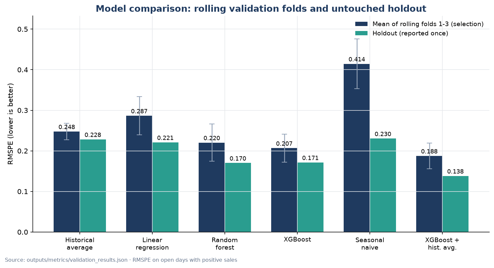

# Model Comparison Report

**Selection metric:** RMSPE on open store-days with positive sales  
**Selection data:** rolling folds 1-3 only  
**Final reporting:** untouched holdout 2015-06-15 – 2015-07-31  
**Machine-readable results:** `outputs/metrics/validation_results.json`, `model_comparison.csv`, `model_comparison_summary.csv`

---

## 1. Validation protocol

| Fold | Train up to | Validation window | Days | Validation rows |
|---|---|---|---:|---:|
| fold_1 | 2014-12-31 | 2015-01-01 – 2015-02-17 | 48 | 53,520 |
| fold_2 | 2015-02-17 | 2015-02-18 – 2015-04-06 | 48 | 53,520 |
| fold_3 | 2015-04-06 | 2015-04-07 – 2015-05-24 | 48 | 53,520 |
| holdout | 2015-06-14 | 2015-06-15 – 2015-07-31 | 47 | 52,405 |

Every model is trained only on data up to `train_end` and forecasts the entire window from a single origin. The holdout is not used for feature selection, hyperparameters or model choice.

**Ensemble.** After the single models were evaluated, a two-member weighted ensemble was formed: **65% XGBoost + 35% historical store-weekday average**. The weight was chosen by a coarse grid (0.50-0.90) on folds 1-3 only; 0.65 minimised the fold mean. The holdout was not involved in choosing the weight. The ensemble requires no extra model fit - it reuses the XGBoost and historical-average predictions - and it corrects the store-level bias that XGBoost alone leaves behind.

---

## 2. Fold-by-fold RMSPE

| Model | fold_1 | fold_2 | fold_3 | Mean (selection) | Std | holdout |
|---|---:|---:|---:|---:|---:|---:|
| **Ensemble 65/35** | **0.2303** | **0.1772** | **0.1553** | **0.1876** | 0.032 | **0.1381** |
| XGBoost | 0.2546 | 0.1911 | 0.1744 | 0.2067 | 0.039 | 0.1714 |
| Random forest | 0.2827 | 0.2041 | 0.1742 | 0.2203 | 0.052 | 0.1700 |
| Historical average | 0.2625 | 0.2616 | 0.2189 | 0.2477 | 0.023 | 0.2283 |
| Linear regression | 0.3500 | 0.2716 | 0.2380 | 0.2866 | 0.057 | 0.2209 |
| Seasonal naive | 0.3966 | 0.3502 | 0.4967 | 0.4145 | 0.110 | 0.2304 |

**Reading.**

* The ensemble wins every single fold and the holdout. It is 24.3% better than the historical average on the selection criterion and 39.5% better on the holdout.
* fold_1 is the hardest window for every model: January-February includes a post-Christmas reset and a level shift that the calendar features cannot fully anticipate.
* fold_3 is the easiest: the seasonal transition is stable.
* XGBoost alone wins the selection among single models, but its fold-2 bias (-14.3%) shows why a pure ML forecast is fragile. The historical-average member acts as an anchor.

---

## 3. Holdout metrics (45,852 scored store-days)

| Model | RMSPE | MAE (PLN) | RMSE (PLN) | WAPE | Bias | n |
|---|---:|---:|---:|---:|---:|---:|
| **Ensemble 65/35 (selected)** | **0.1381** | **826.7** | **1,179.9** | **11.6%** | **-7.9%** | 45,852 |
| Random forest | 0.1700 | 913.5 | 1,282.2 | 12.8% | -6.8% | 45,852 |
| XGBoost | 0.1714 | 1,008.2 | 1,350.5 | 14.1% | -10.8% | 45,852 |
| Linear regression | 0.2209 | 1,202.8 | 1,940.3 | 16.8% | -9.6% | 45,852 |
| Historical average | 0.2283 | 1,259.4 | 1,666.0 | 17.6% | -2.6% | 45,852 |
| Seasonal naive | 0.2304 | 1,466.7 | 2,083.9 | 20.5% | -15.2% | 45,852 |

**Why the ensemble wins.** The historical average already captures the store's level and weekly pattern; XGBoost captures promotions, holidays and non-linear interactions. Their errors are imperfectly correlated: blending 35% of the average removes part of the ML model's level bias while keeping most of its signal. The result improves RMSPE, MAE and WAPE at the same time, so it is not a metric-specific trick.

---

## 4. Bias analysis

Bias is the mean signed error `(prediction - actual) / actual`; positive means over-forecasting.

| Model | fold_1 | fold_2 | fold_3 | holdout |
|---|---:|---:|---:|---:|
| Ensemble 65/35 | -0.5% | -10.3% | -1.6% | -7.9% |
| XGBoost | -0.9% | -14.3% | +0.2% | -10.8% |
| Random forest | -0.1% | -13.5% | -3.6% | -6.8% |
| Historical average | — | — | — | -2.6% |
| Linear regression | — | — | — | -9.6% |
| Seasonal naive | — | — | — | -15.2% |

**Interpretation.** The ensemble cuts XGBoost's fold-2 bias from -14.3% to -10.3% and the holdout bias from -10.8% to -7.9%. It does not eliminate the regime effect: in fold_3 it is nearly unbiased (-1.6%), in fold_2 it is still -10.3%. A production system should still calibrate or carry a safety buffer, but the raw forecast is materially less dangerous than the single-model one.

---

## 5. Error analysis by segment (selected ensemble, holdout)

### 5.1 Store type

| Store type | n | RMSPE | MAE | WAPE | Mean actual | Mean predicted |
|---|---:|---:|---:|---:|---:|---:|
| a | 24,699 | 0.143 | 835 | 11.9% | 7,048 | 6,485 |
| d | 14,286 | 0.133 | 832 | 11.6% | 7,150 | 6,534 |
| c | 6,068 | 0.135 | 780 | 11.1% | 7,027 | 6,544 |
| b | 799 | **0.098** | 816 | 7.5% | 10,916 | 10,628 |

**Reading.** Type a remains the hardest segment (0.143) and is still under-forecast by 8.0%. Type b is the easiest (0.098). The ensemble reduced type-a error from 0.183 (XGBoost alone) to 0.143 - the largest single improvement, because type-a stores carry the strongest store-level bias.

### 5.2 Weekday

| Weekday | n | RMSPE | MAE | Mean actual | Mean predicted |
|---|---:|---:|---:|---:|---:|
| Sunday | 193 | 0.174 | 1,007 | 8,513 | 7,765 |
| Saturday | 6,682 | 0.152 | 685 | 5,644 | 5,221 |
| Monday | 7,796 | 0.142 | 1,014 | 8,526 | 7,940 |
| Friday | 7,795 | 0.139 | 800 | 7,101 | 6,492 |
| Tuesday | 7,796 | 0.139 | 918 | 7,519 | 6,871 |
| Thursday | 7,794 | 0.129 | 762 | 6,883 | 6,325 |
| Wednesday | 7,796 | 0.127 | 757 | 6,946 | 6,409 |

**Reading.** Sunday has the highest error but only 193 scored days (most stores closed) and should not drive conclusions. Among full weekdays, Saturday is the hardest (0.152) and the most under-forecast (-7.5%).

### 5.3 Promotion

| Promo | n | RMSPE | MAE | WAPE | Mean actual | Mean predicted |
|---|---:|---:|---:|---:|---:|---:|
| 0 | 23,581 | 0.136 | 620 | 10.5% | 5,905 | 5,619 |
| 1 | 22,271 | 0.140 | 1,046 | 12.4% | 8,456 | 7,598 |

**Reading.** The ensemble is nearly neutral between promo and non-promo days (0.140 vs 0.136). The historical-average member dilutes part of the promo uplift - a deliberate trade-off: it buys a better base level and much lower bias, at the cost of some sharpness on promotion days.

### 5.4 Sales decile

| Decile (1 = lowest sales) | n | RMSPE | MAE (PLN) | Mean actual |
|---|---:|---:|---:|---:|
| 1 | 4,589 | 0.175 | 357 | 3,195 |
| 2 | 4,588 | 0.116 | 394 | 4,369 |
| 3 | 4,581 | 0.113 | 452 | 5,050 |
| 4 | 4,592 | 0.117 | 528 | 5,653 |
| 5 | 4,583 | 0.124 | 628 | 6,250 |
| 6 | 4,581 | 0.125 | 714 | 6,908 |
| 7 | 4,584 | 0.134 | 859 | 7,665 |
| 8 | 4,583 | 0.142 | 1,035 | 8,591 |
| 9 | 4,585 | 0.150 | 1,282 | 9,963 |
| 10 | 4,586 | 0.170 | 2,018 | 13,804 |

**Reading.** Relative error is now U-shaped: highest in the smallest decile (0.175) and the largest decile (0.170), lowest in the middle (0.113-0.125). The top decile also has the largest absolute error (MAE 2,018 PLN). The ensemble helps the middle of the distribution most; the extremes remain the difficult cases.

### 5.5 Worst stores

| Store | Scored days | RMSPE | Bias |
|---|---:|---:|---:|
| 292 | 23 | 0.916 | -23.5% |
| 909 | 27 | 0.594 | -36.4% |
| 782 | 41 | 0.451 | +0.3% |
| 876 | 27 | 0.395 | -33.1% |
| 722 | 41 | 0.326 | +30.5% |
| 839 | 41 | 0.284 | +11.2% |
| 534 | 41 | 0.269 | -11.7% |
| 286 | 41 | 0.265 | +5.3% |

**Reading.** Several of the worst stores have fewer than 47 scored days: they opened late or closed temporarily during the holdout. Their history is short and their level is unstable. These are candidates for manual review or a store-specific model. The best stores (not shown) score RMSPE below 0.08 with near-zero bias.

---

## 6. Econometric benchmark

| Model | Store 1 holdout RMSPE | MAE (PLN) |
|---|---:|---:|
| Global linear regression | 0.1032 | 367.0 |
| Global random forest | 0.1115 | 400.0 |
| SARIMAX (Store 1 only) | 0.1234 | 404.1 |
| Global XGBoost | 0.1264 | 433.7 |
| Seasonal naive | 0.1782 | 713.4 |
| Historical average | 0.2017 | 669.7 |

On a single stable store, a global linear model and a single-store SARIMAX can beat the global gradient boosting model. With 41 scored days this ranking is noisy, and none of these models is calibrated. The result illustrates that "best model" is objective-specific: chain-wide ranking, single-store accuracy and interpretability do not have to agree.

---

## 7. Conclusions

1. **The 65/35 ensemble is the best model** on the pre-registered selection criterion: 0.1876 mean RMSPE across folds, 0.1381 on the holdout.
2. **The ensemble improves every headline metric at once** - RMSPE, MAE, WAPE and bias - so the gain is not an artefact of one metric.
3. **XGBoost is the best single model** (0.2067 folds, 0.1714 holdout), but its bias is volatile (-14.3% in fold_2).
4. **The historical average remains a valuable anchor.** It is not the most accurate model, but it stabilises the ensemble and cuts the level bias.
5. **Bias is still the main residual risk.** -7.9% on the holdout means inventory plans need a buffer or calibration.
6. **Segment errors are actionable**: type-a stores, Saturdays and the smallest/largest sales deciles deserve attention; type-b stores are already well forecast.

---

## 8. Limitations

* One holdout window; seasonal luck is possible.
* The ensemble weight (0.65) was chosen on three folds; a different period could favour a different weight.
* Hyperparameters were set a priori, not tuned; a proper search could improve RMSPE but risks overfitting the folds.
* No prediction intervals for the ML models; SARIMAX provides them, but only for one store.
* The comparison does not include a hierarchical or store-specific ensemble.
* The submission is uncalibrated by design; calibration is documented as future work.
